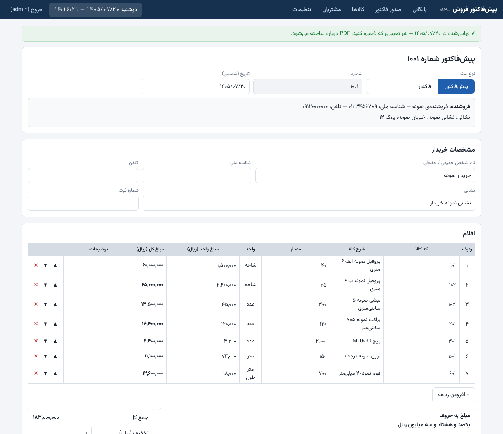
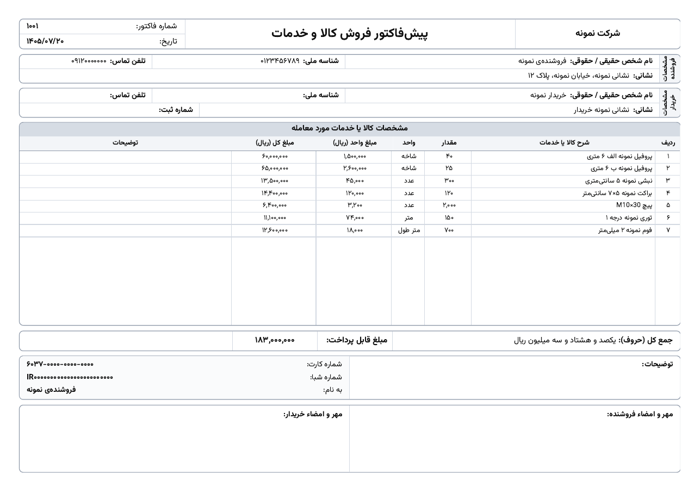
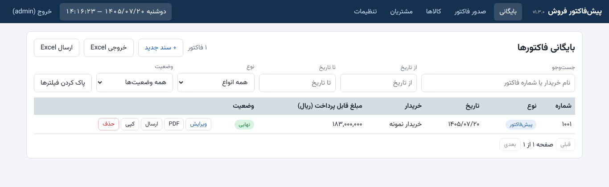

# پنل پیش‌فاکتور فروش

پنل تحت وب فارسی (راست‌به‌چپ) برای صدور **پیش‌فاکتور و فاکتور فروش**: کالاها یک بار با کد تعریف می‌شوند و در فاکتور فقط کد را می‌نویسید؛ شرح، واحد و قیمت خودکار پر می‌شود. خروجی PDF یک‌صفحه‌ای (A4 افقی)، بایگانی، خروجی Excel، ورود کالا از Excel و ارسال با ربات به تلگرام و بله (با پشتیبانی پروکسی) و واتساپ.

| نسخه‌ی چاپی / PDF | بایگانی |
|---|---|
|  |  |

> داده‌های این تصاویر ساختگی است. برنامه با اطلاعات **خالی** شروع می‌شود (بدون کالا، قیمت یا نام پیش‌فرض).

**همه‌ی اطلاعات (دیتابیس، PDFها، مهر، لوگو، بکاپ‌ها) داخل یک پوشه‌ی `data` ذخیره می‌شود.**

## امکانات

- کالاها با کد و **دسته‌بندی‌های قابل مدیریت** (کد گروه = رقم صدگان کد؛ گروه تعریف‌نشده «متفرقه» می‌شود)، **ورود دسته‌جمعی از Excel**
- پیش‌فاکتور و فاکتور (عنوان و شماره‌گذاری جدا از هم قابل تنظیم)، تاریخ شمسی، مالیات و تخفیف، مبلغ به حروف
- PDF مینیمال A4 افقی ساخته‌شده در سرور؛ مهر و **لوگو** (به‌جای نام شرکت در سربرگ) اختیاری
- چند حساب بانکی (کارت/شبا/حساب) و انتخاب آن‌ها در هر فاکتور
- ویرایش و حذف کامل فاکتورها، کپی فاکتور، بایگانی با جست‌وجو و فیلتر، خروجی Excel
- **ارسال به تلگرام و بله** با ربات (فاکتور، فهرست فاکتورها، فهرست کالاها)، با **پروکسی HTTP/SOCKS5** برای تلگرام؛ **واتساپ** به‌صورت نیمه‌خودکار
- رنگ نوار بالا قابل تغییر، نمایش ساعت و تقویم شمسی (وقت تهران)
- **بررسی و نصب نسخه‌ی جدید با یک دکمه** (نسخه‌ی exe ویندوز)

## نسخه‌ی آماده‌ی ویندوز (بدون نصب Node.js) — پیشنهادی

1. از صفحه‌ی **[Releases](../../releases)** فایل `FactorMaker-win-x64.zip` را بگیرید و باز کنید.
2. `FactorMaker.exe` را اجرا کنید (اگر SmartScreen هشدار داد: *More info ← Run anyway*). مرورگر خودش باز می‌شود: `http://127.0.0.1:3000`
3. ورود اولیه: `admin` / `admin1234` — **حتماً** در «تنظیمات ← تغییر رمز» عوض کنید.

ساخت PDF به **Chrome یا Edge** روی همان کامپیوتر نیاز دارد (Edge در ویندوز ۱۰/۱۱ هست). برای توقف، پنجره‌ی سیاه را ببندید.

### به‌روزرسانی
در **تنظیمات ← نسخه و به‌روزرسانی** دکمه‌ی «بررسی نسخه‌ی جدید» را بزنید. اگر نسخه‌ی تازه‌ای باشد، یک نشان زرد هم بالای صفحه می‌آید. با «به‌روزرسانی» و تأیید شما: از دیتابیس بکاپ گرفته می‌شود، نسخه‌ی جدید از GitHub دانلود و با هش بررسی می‌شود، برنامه بسته و نسخه‌ی جدید خودکار اجرا می‌شود (بعد از چند ثانیه صفحه را با `Ctrl+F5` رفرش کنید). پوشه‌ی `data` هرگز دست نمی‌خورد.

- **مخزن عمومی (public):** بدون هیچ تنظیمی کار می‌کند.
- **مخزن خصوصی (private):** برنامه‌ی نصب‌شده روی کامپیوتر وارد GitHub نشده و GitHub برای مخزن خصوصی «۴۰۴» می‌دهد؛ پس یک **توکن فقط‌خواندنی** لازم است: GitHub ← Settings ← Developer settings ← Personal access tokens ← *Fine-grained tokens* ← فقط همین مخزن، دسترسی **Contents: Read-only** ← توکن را در همان بخش تنظیمات بنویسید. (توکن تاریخ انقضا دارد؛ بعد از انقضا باید نو شود.)
- **GitHub از اینترنت شما بسته است؟** «پروکسی» را در بخش اشتراک‌گذاری تعریف کنید و در بخش به‌روزرسانی «استفاده از پروکسی» را تیک بزنید؛ یا از «صفحه‌ی دانلود» دستی بگیرید.
- به‌روزرسانی یک‌کلیکی فقط در نسخه‌ی exe کار می‌کند؛ اگر برنامه را از سورس اجرا می‌کنید، نسخه‌ی جدید را دستی بگیرید.

## اجرا از روی سورس

1. **Node.js ۲۲ یا بالاتر** (<https://nodejs.org>، گزینه LTS).
2. ویندوز: روی `start.bat` دوبار کلیک کنید (بار اول خودش نصب می‌کند). مک/لینوکس: `./start.sh`. یا: `npm install` و `npm start`.
3. مرورگر: <http://127.0.0.1:3000>

برای ساخت exe: `npm run build:exe` (خروجی در `release/`). اجرای تست‌ها: `npm test`.

## راه‌اندازی اولیه (بعد از اولین ورود)

در **تنظیمات** این‌ها را وارد کنید: عنوان شرکت، مشخصات فروشنده، «شماره‌ی آخرین فاکتور صادرشده» (فاکتور بعدی یکی بیشتر می‌شود)، درصد مالیات و متن توضیحات. سپس حساب‌های بانکی، مهر، لوگو و رنگ پوسته را در صورت نیاز. فونت **B Yekan** را داخل پوشه‌ی `fonts` بگذارید (نام فایل شامل `Yekan` باشد؛ بدون آن Vazirmatn استفاده می‌شود) و برنامه را دوباره اجرا کنید.

## راهنمای استفاده‌ی روزانه

### کالاها و ورود از Excel
- **دستی:** «کالاها ← کالای جدید» (کد، شرح، واحد، قیمت). کد یکتاست. کالای استفاده‌شده در فاکتور حذف نمی‌شود، «غیرفعال» کنید.
- **از Excel:** «کالاها ← ورود از Excel». فایل نمونه‌ی ساختگی: [`samples/products-sample.xlsx`](samples/products-sample.xlsx) (از همان پنجره هم قابل دانلود است). ستون‌ها در ردیف اول:

  | کد کالا | شرح کالا | واحد | مبلغ واحد (ریال) | فعال (اختیاری) |
  |---|---|---|---|---|
  | ۱۰۱ | پروفیل نمونه | شاخه | ۱,۵۰۰,۰۰۰ | بله |

  ارقام فارسی/انگلیسی و جداکننده‌ی هزارگان پذیرفته می‌شود. قبل از ورود، پیش‌نمایش (تازه / به‌روزرسانی / خطا) نشان داده می‌شود. اگر کد از قبل بود، انتخاب می‌کنید نادیده گرفته شود یا به‌روز شود. کدهای تکراری در فایل و ردیف‌های نامعتبر خطا حساب می‌شوند (با تیک «نادیده گرفتن ردیف‌های خطادار» رد می‌شوند). «خروجی Excel» همان قالب را برای ویرایش و ورود دوباره می‌دهد.

### صدور فاکتور
> **میان‌بر:** در «کالاها» چند کالا را تیک بزنید (یا تیک سرستون برای همه) و در نوار پایین «افزودن به فاکتور جدید» را بزنید؛ فرم فاکتور با همان کالاها (و قیمت لیست) پر می‌شود و فقط مقدار را وارد می‌کنید.

1. «صدور فاکتور»: نوع سند (**پیش‌فاکتور** یا **فاکتور**) و تاریخ را بزنید. نام خریدار را بنویسید تا از مشتریان پیشنهاد شود.
2. در هر ردیف کد یا بخشی از نام کالا را بنویسید؛ لیست شناور کالاها (دسته‌بندی‌شده) باز می‌شود. فقط مقدار را وارد کنید. قیمتِ تغییرداده‌شده زرد می‌شود؛ کد نامعتبر قرمز.
3. در صورت نیاز تخفیف، مالیات، توضیحات و اطلاعات پرداخت (حساب بانکی) را تنظیم کنید؛ کادر «توضیحات» نصف می‌شود و کارت/شبا کنارش می‌آید.
4. **ذخیره پیش‌نویس** یا **ثبت نهایی**. فاکتورها (حتی نهایی) بعداً با «ویرایش» باز و با «حذف» پاک می‌شوند؛ ذخیره‌ی ویرایشِ نهایی، PDF را دوباره می‌سازد و شرح/قیمتِ ردیف‌های قبلی را عوض نمی‌کند.
5. **پیش‌نمایش چاپ**، **دانلود PDF** (نام فایل: «شماره - نام خریدار.pdf»)، **ارسال**، **کپی گرفتن**.

### ارسال به تلگرام / بله (با ربات) و واتساپ
در **تنظیمات ← اشتراک‌گذاری** برای هر پیام‌رسان: تیک فعال، **توکن ربات**، **شناسه‌ی چت/کانال** (چند مقصد با ویرگول) و در صورت نیاز آدرس API را وارد و «ذخیره و ارسال آزمایشی» را بزنید.
- تلگرام: ربات با [@BotFather](https://t.me/BotFather)؛ بله: [@botfather](https://ble.ir/botfather) در بله. ربات باید عضو چت یا کانال مقصد باشد.
- **پروکسی (برای تلگرام در ایران):** در همان کارت، «آدرس پروکسی» را بنویسید و برای تلگرام «ارسال از طریق پروکسی» را تیک بزنید. پروکسی HTTP (`http://127.0.0.1:10809`) و SOCKS4/5 (`socks5://127.0.0.1:10808`) پشتیبانی می‌شود؛ اگر از v2rayN، Clash، Nekoray و مشابه استفاده می‌کنید، آدرس پورت محلی آن را بدهید. اگر آدرس یک آینه/رله‌ی API دارید، در «آدرس API» بنویسید.
- بعد از آن دکمه‌ی **ارسال** در فاکتور، سطرهای بایگانی، «ارسال Excel» در بایگانی و «ارسال» در کالاها کار می‌کند. در فرم فاکتور هم می‌توانید تیک بزنید «پس از ثبت نهایی ارسال شود».
- **واتساپ (دستی):** ارسال خودکار واتساپ پشتیبانی نمی‌شود (API رسمی آن نیاز به تأیید کسب‌وکار در Meta دارد و بدون فیلترشکن معمولاً در دسترس نیست؛ روش‌های غیررسمی هم خطر مسدود شدن شماره را دارند). در پنجره‌ی «ارسال»، بخش واتساپ: شماره‌ی گیرنده (اختیاری) را بنویسید و «باز کردن واتساپ» را بزنید؛ فایل دانلود می‌شود و واتساپ با متن آماده باز می‌شود، فایل را داخل چت بکشید. هیچ تنظیم یا توکنی لازم نیست و تا وقتی واتساپ برای شما کار می‌کند، همین هم کار می‌کند.
- **نام فایل و متن ارسال:** در «تنظیمات ← قالب نام فایل و متن ارسال» انتخاب کنید نام فایل شامل چه چیزهایی باشد (نوع سند، شماره، تاریخ، نام خریدار؛ تکی یا ترکیبی، با جداکننده‌ی دلخواه)، متن همراه فایل چه چیزهایی داشته باشد (عنوان، تاریخ، خریدار، مبلغ و یک خط دلخواه)، و **ترتیب ارسال**: متن زیر خود فایل، یا اول متن (پیام جدا) و بعد فایل، یا فقط فایل. نمونه‌ی زنده همان‌جا نشان داده می‌شود. در پنجره‌ی «ارسال» هم برای همان بار قابل تغییر است و فایل واتساپ هم با همین قالب نام‌گذاری می‌شود.
- توکن‌ها فقط روی همین کامپیوتر ذخیره می‌شوند و به مرورگر برنمی‌گردند.
- ⚠️ ارسال با سرورهای ساختگی (از جمله پروکسی‌های ساختگی HTTP و SOCKS5) آزمون شده؛ تلگرام/بله‌ی واقعی را با «ذخیره و ارسال آزمایشی» امتحان کنید.

### دسته‌بندی‌ها و کد گروه
در «کالاها ← دسته‌بندی‌ها» دسته‌ها را اضافه، ویرایش یا حذف کنید. **کد گروه** مضرب ۱۰۰ است و همان رقم صدگانِ کد کالاست (کالای ۳۰۲ ← گروه ۳۰۰؛ ۷۰۵ ← ۷۰۰). برای کدی که گروهش تعریف نشده، در همه‌جا (جدول، لیست انتخاب کالا، خروجی Excel) «متفرقه» نوشته می‌شود. حذف یک دسته، کالاها را پاک نمی‌کند؛ فقط «متفرقه» نمایش داده می‌شوند. بالای جدول کالاها هم می‌توانید بر اساس دسته فیلتر کنید.

### ظاهر: رنگ و لوگو
**تنظیمات ← ظاهر:** رنگ نوار بالا را از رنگ‌های آماده یا انتخابگر رنگ تغییر دهید. لوگو (PNG/JPG) را بارگذاری کنید و انتخاب کنید در سربرگ چاپی **نام شرکت** نمایش داده شود یا **لوگو**.

### بایگانی و Excel
جست‌وجو با نام/شماره، فیلتر بازه‌ی تاریخ شمسی، نوع و وضعیت؛ «خروجی Excel» فهرست فیلترشده را برای حسابداری می‌دهد.

### بکاپ‌گیری (حداقل هفته‌ای یک بار)
- کل پوشه‌ی **`data`** را (وقتی برنامه بسته است) کپی کنید؛ شامل دیتابیس، PDFها، مهر و لوگو.
- یا «تنظیمات ← دانلود بکاپ دیتابیس»، یا `npm run backup` (فایل در `data/backups`).
- بازگردانی: برنامه را ببندید و `factormaker.db` را با فایل بکاپ جایگزین کنید.

## نکات فنی

| مورد | توضیح |
|---|---|
| دیتابیس | SQLite در `data/factormaker.db` (بدون نیاز به نصب جداگانه) |
| PDF | در سرور با Chromium؛ فاکتور نهایی PDF خود را در `data/pdfs` نگه می‌دارد |
| تاریخ شمسی | کتابخانه‌ی `jalaali-js`؛ «امروز» با منطقه‌ی زمانی Asia/Tehran |
| شماره‌گذاری | `max(شماره‌ی آخرین فاکتور تنظیمات، بزرگ‌ترین شماره‌ی ثبت‌شده) + ۱`؛ پیش‌فاکتور و فاکتور یک ردیف مشترک دارند |
| ستون «کد کالا» در چاپ | پیش‌فرض مخفی؛ در تنظیمات قابل روشن شدن است |
| ردیف‌ها | تا ۱۴ ردیف اندازه‌ی کامل؛ ۱۵ تا ۲۵ با فونت کوچک‌تر در یک صفحه؛ بیشتر چندصفحه با تکرار سرستون |
| مرورگر PDF | اگر پیدا نشد، متغیر `CHROME_PATH` را به مسیر Chrome/Edge بدهید |

## تاریخچه‌ی نسخه‌ها

- **۱.۳.۱** — انتخاب چندتایی کالا در «کالاها» و «افزودن به فاکتور جدید»؛ رفع آزمون به‌روزرسانی و بالا بردن نسخه‌ی اکشن‌های GitHub (هشدار Node 20).
- **۱.۵.۰** — قالب نام فایل و متن ارسال و ترتیب ارسال (کپشن / اول متن / بدون متن)، رفع بررسی نسخه برای مخزن خصوصی (توکن) و بدون وابستگی به سهمیه‌ی API گیت‌هاب، پروکسی برای به‌روزرسانی، پیام‌های خطای دقیق‌تر.
- **۱.۴.۰** — دسته‌بندی‌ها و کد گروه قابل مدیریت («متفرقه» برای گروه تعریف‌نشده)، پشتیبانی پروکسی HTTP/SOCKS5 برای تلگرام و بله، واتساپ نیمه‌خودکار، حذف ایتا.
- **۱.۳.۱** — انتخاب چندتایی کالا برای فاکتور جدید، رفع به‌روزرسانی ویندوز.
- **۱.۳.۰** — ورود کالا از Excel (با فایل نمونه)، ارسال به تلگرام/بله/ایتا، به‌روزرسانی یک‌کلیکی از داخل برنامه، رنگ نوار بالا، لوگو به‌جای نام شرکت، اسکرین‌شات در README.
- **۱.۲.۲** — رفع خطای پنهان یافتن مرورگر در نسخه‌ی exe.
- **۱.۲.۱** — بسته‌ی اجرایی ویندوز (.exe) در Releases، بسته شدن سریع برنامه.
- **۱.۲.۰** — حساب‌های بانکی، شروع با اطلاعات خالی.
- **۱.۱.۰** — نوع سند، ویرایش/حذف کامل، چاپ مینیمال، ساعت و تقویم شمسی، نمایش نسخه.
- ۱.۰.۰ — نسخه‌ی اول.
